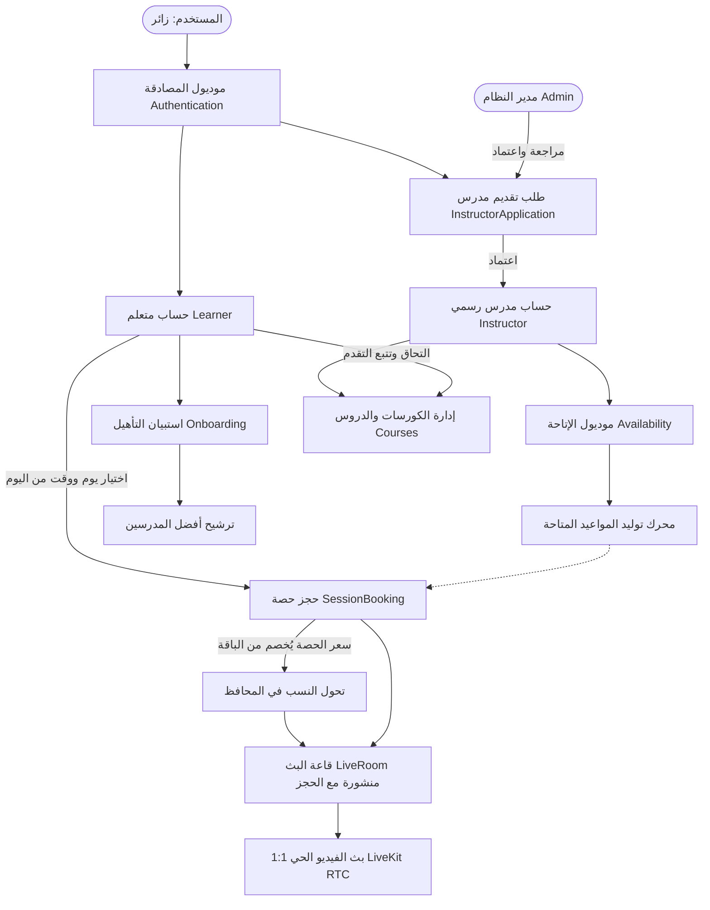

# الدليل الشامل لمعمارية النظام وتدفق الميزات (LMS Architecture & Feature Flows)

هذا المستند يشرح بالتفصيل المعمارية الشاملة لمنصة **LMS**، وكافة الميزات المنفذة في النظام، وكيف تترابط مع بعضها البعض عبر سيناريوهات عملية خطوة بخطوة من البداية وحتى النهاية.

---

## 1. المعمارية الهندسية للنظام (Architecture Overview)

المشروع مبني باتباع معايير **Clean Architecture** الصارمة مع نمط **CQRS (Command Query Responsibility Segregation)** باستخدام مكتبة **MediatR**:

```text
┌─────────────────────────────────────────────────────────────┐
│                       LMS.API Layer                         │
│   (Controllers, Security Middlewares, Swagger, Hangfire)    │
└──────────────────────────────┬──────────────────────────────┘
                               │
┌──────────────────────────────▼──────────────────────────────┐
│                    LMS.Application Layer                    │
│   (Commands, Queries, Validators, DTOs, Pipeline Behaviors) │
└──────────────┬───────────────────────────────┬──────────────┘
               │                               │
┌──────────────▼──────────────┐ ┌──────────────▼──────────────┐
│     LMS.Domain Layer        │ │  LMS.Infrastructure Layer   │
│ (Entities, Enums, Contracts)│ │ (JWT, LiveKit Token, Email, │
└──────────────▲──────────────┘ │   File Validators, Hashing) │
               │                └──────────────┬──────────────┘
┌──────────────┴──────────────┐                │
│    LMS.Persistence Layer    │◄───────────────┘
│ (DbContext, Configurations, │
│  Migrations, Query Filters) │
└─────────────────────────────┘
```

### المبادئ المطبقة في النظام:
1. **عزل الصلاحيات واستنتاج الهوية:** المتحكمات والـ Handlers تستنتج هوية المتصل ودوره من التوكن (`ICurrentUserService`) ولا تسمح للعميل باختيار دوره أو التلاعب به.
2. **الحذف اللين الشامل (Soft Delete):** كل الجداول تدعم `IsDeleted` مع `Global Query Filter` في EF Core لضمان عدم ظهور البيانات المحذوفة.
3. **الأمان متعدد الطبقات (Security in Depth):**
   * هيدرز متقدمة (`ContentSecurityPolicy`, `PermissionsPolicy`, `HSTS`, `X-Frame-Options`).
   * حماية ضد هجمات القوة الغاشمة ومعدل الطلبات (`IpRateLimiting`).
   * تشفير التوكنات وتوقيعات RTC بالمعيار الأحدث `HMAC-SHA256`.

---

## 2. خريطة الأنظمة والموديولات والعلاقات بينها



---

## 3. السيناريوهات الكاملة بالتفصيل (End-to-End Scenarios)

### السيناريو 1: رحلة المدرس من التسجيل وحتى إنهاء الحصة المباشرة
1. **التسجيل الأولي:**
   * يسجل المستخدم عبر `POST /api/v1/authentication/register`.
   * يصل رمز تحقق OTP إلى بريده الإلكتروني ويقوم بتأكيده عبر `POST /api/v1/authentication/verify-otp`.
2. **التقديم كمدرس (`InstructorApplication`):**
   * يقدم سيرته الذاتية، مؤهلاته التعليمية، وخبراته عبر `POST /api/v1/instructor-applications`.
   * يراجع الأدمن الطلب ويعتمده عبر `POST /api/v1/instructor-applications/approve`.
   * النظام يقوم تلقائياً بإنشاء كيان `Instructor` وربطه بالـ `ApplicationUser` وترقية صلاحيته إلى دور `Instructor`.
3. **إعداد الملف الشخصي وسعر الساعة:**
   * يحدد المدرس نبذته وسعر الساعة التعليمية (`HourlyRate`) عبر `PUT /api/v1/instructor-profile`.
4. **تحديد أوقات العمل والإتاحة (`Availability`):**
   * يحدد المدرس أيامه وساعاته المتاحة أسبوعياً عبر `POST /api/v1/my-availability/window`.
   * خدمة `AvailabilityMaterializationService` تقوم بحساب النوافذ الزمنية وتحويلها إلى فترات قابلة للحجز (`Bookable Slots`).
5. **الحجز يصبح نافذًا بدون موافقة المدرس:**
   * يحجز الطالب يومًا ووقتًا محدداً عبر `POST /api/v1/sessions` بحقول `instructorId` و `date` و `startTime` و `durationMinutes`؛ الباك إند يتحقق أن الفترة المطلوبة تقع داخل نافذة إتاحة مفتوحة للمدرس ذلك اليوم ولا تتعارض مع جلسته أو جلساته هو.
   * المقعد يُحجز للطالب فورًا بحالة `Confirmed` على `SessionBooking`، بينما تبقى الحصة `Pending` أي "بانتظار الدفع" — لا يوجد أي دور للمدرس في قبول الحجز أو رفضه.
   * **ما يحدث خلف الكواليس:**
     - ينشئ النظام تلقائياً كيان `LiveRoom` مخصص لهذه الحصة مع قناة فريدة ثابتة `live-{sessionId:N}` وحالة `NotStarted`.
     - إن لم يدفع الطالب قبل لحظة بداية الحصة، تلغى الحجز تلقائياً ويعود مقعد الإتاحة متاحًا.
     - عند الدفع (`POST /api/v1/sessions/{id}/pay`) تُخصم ساعات الباقة، تتحول الحصة إلى `Confirmed`، وتُحفظ نسبة المدرس في `PendingBalance` ونسبة المنصة في `CommissionAmount` داخل نفس حركة المحفظة، ثم تُحرَّر إلى `AvailableBalance` عند انتهاء الحصة.
6. **دخول الحصة وبدء البث الحي:**
   * قبل موعد الحصة بـ 15 دقيقة (أو أثناء وقتها)، يضغط المدرس على "بدء الحصة".
   * يستدعي المتصفح `POST /api/v1/live-classes/{sessionId}/start`.
   * يتحقق النظام أن المتصل هو مدرس الحصة وأن الموعد قد حان.
   * يتم توليد توكن وصول LiveKit (JWT موقّع بـ HMAC-SHA256) يمنح صلاحية `roomJoin` + `canPublish` وهوية `identity` مشتقة من حسابه.
   * تتغير حالة الغرفة إلى `Live` ويوثق توقيت البدء `StartedAtUtc`.
   * يسجل في جدول `LiveRoomParticipants` أن المدرس انضم كـ `Host`.
   * يفتح المتصفح كاميرا وميكروفون المدرس ويتصل مباشرة بسحابة LiveKit Cloud.
7. **إنهاء الحصة:**
   * بعد انتهاء الحصة يضغط المدرس على "إنهاء الحصة".
   * يتم استدعاء `POST /api/v1/live-classes/{sessionId}/end`.
   * تتغير حالة الغرفة إلى `Ended`، وتغلق كافة سجلات الحضور النشطة ويوثق وقت الخروج بدقة.

---

### السيناريو 2: رحلة المتعلم من الاستبيان وحتى التفاعل بالصوت والصورة
1. **التسجيل والتأهيل (Onboarding):**
   * يسجل المتعلم حسابه ويجيب على أسئلة التأهيل عبر `POST /api/v1/onboarding/answers` (المجالات المهتم بها، مستواه، أهدافه).
   * يستدعي `GET /api/v1/onboarding/instructors` ليحصل على قائمة بأفضل المدرسين المطابقين لاحتياجاته ومستواه.
2. **استعراض مواعيد المدرس وحجز حصة:**
   * يستعلم المتعلم عن المواعيد المتاحة للمدرس عبر `GET /api/v1/sessions/bookable-slots?instructorId={id}`.
   * يختار موعداً مناسباً ويحجز عبر `POST /api/v1/sessions/book`.
   * تُنشأ الحصة بانتظار موافقة المدرس.
3. **متابعة الحجز في قائمة حصصي:**
   * يستعلم المتعلم عن حصصه عبر `GET /api/v1/sessions/my-bookings`.
   * الكائن المرجع يحتوي على كتلة ذكية `live`:
     ```json
     "live": {
       "roomId": "e3b0c442-...",
       "status": "NotStarted",
       "canJoinNow": false,
       "joinOpensAtUtc": "2026-11-08T14:45:00Z"
     }
     ```
   * الفرونت إند يعرض عداداً تنازلياً لموعد فتح الغرفة.
4. **الانضمام للبث الحي:**
   * عند حلول نافذة الدخول (`canJoinNow = true`)، يظهر زر "انضمام الآن".
   * يستدعي متصفح المتعلم `POST /api/v1/live-classes/{sessionId}/join`.
   * يتحقق النظام أن هذا المتعلم يملك حجزاً مؤكداً في هذه الحصة.
   * يصدر له توكن وصول خاص بـ `identity` المميز له (نفس الرقم المخزّن في عمود `AgoraUid` — الاسم باقٍ في قاعدة البيانات ولا علاقة له بالمزوّد).
   * يسجل في `LiveRoomParticipants` حضور المتعلم كـ `Attendee`.
   * يبدأ الاتصال المرئي ثنائي الاتجاه (صوت وصورة 1:1) عبر LiveKit RTC.
5. **تجديد التوكن أثناء الحصة (Keep-Alive):**
   * صلاحية التوكن الصادرة من السيرفر (`TokenLifetimeMinutes`) أطول من مدة الحصة الافتراضية، فلا يلزم تجديد أثناءها.
   * عند الحاجة (حصة طويلة أو إعادة اتصال)، يستدعي الفرونت `POST /api/v1/live-classes/{sessionId}/token` ويستخدم التوكن الجديد عند أول اتصال لاحق — مكتبة `livekit-client` تجدّد التوكن داخلياً بعد ذلك ولا تحتاج منه شيئاً أثناء الجلسة.
6. **مغادرة الحصة:**
   * عند إغلاق الطالب للمكالمة، يتم استدعاء `POST /api/v1/live-classes/{sessionId}/leave` لتوثيق وقت خروجه بدقة.

---

### السيناريو 3: إعادة الجدولة وإلغاء الحصص (Rescheduling & Cancellation Rules)
* **طلب إعادة الجدولة:**
  - يمكن للمدرس أو المتعلم طلب موعد جديد عبر `POST /api/v1/reschedule-requests`.
  - عندما يوافق الطرف الآخر عبر `POST /api/v1/reschedule-requests/approve`:
    1. يتحقق النظام أولاً: إذا كانت الغرفة قد بدأت بالفعل (`Live`) أو انتهت (`Ended`)، **يُرفض التعديل قطيعاً**.
    2. إذا كانت مؤكدة ولم تبدأ بعد، يتم نقل توقيت الحصة إلى الموعد الجديد.
    3. **قاعدة ذهبية:** اسم قناة البث لا يتغير إطلاقاً (`live-{sessionId:N}`) لأنه مشتق من رقم الحصة وليس من تاريخها، وبالتالي لا ينكسر أي رابط لدى العميل.
* **إلغاء الحصة:**
  - يتم استدعاء `POST /api/v1/sessions/cancel`.
  - وضعنا حماية أمنية برمجية صارمة: **ممنوع إلغاء أي حصة إذا كانت حالة غرفتها `Live`**. يجب إنهاء الحصة أولاً قبل اتخاذ إجراءات الإلغاء.

---

### السيناريو 4: نظام الكورسات والدروس والاختبارات (Self-Paced Courses)
* **إنشاء الكورس:**
  - يقوم المدرس أو الأدمن بإنشاء الكورس وتحديد مستواه وتفاصيله وصورته.
  - إضافة الدروس والمحتوى المكتوب وروابط الفيديو والمرفقات.
  - إضافة أسئلة كويز تفاعلية لكل درس مع خياراتها وتحديد الإجابة الصحيحة.
* **دراسة الكورس من المتعلم:**
  - المتعلم يلتحق بالكورس عبر `POST /api/v1/courses/{id}/enroll`.
  - يفتح الدرس ويشاهد المحتوى، ثم يسجل إتمام الدرس عبر `POST /api/v1/courses/lessons/{id}/progress`.
  - يحل الكويز عبر `POST /api/v1/courses/lessons/{id}/quiz` ويقوم النظام فوراً بتصحيح الإجابات واحتساب النسبة المئوية للنجاح وتوثيق المحاولة (`QuizAttempt`).

---

## 4. مصفوفة الـ Endpoints الخاصة بالبث المباشر (Live Classes API Reference)

| المسار (Route) | الطريقة (Method) | الصلاحية (Role) | الوظيفة |
|---|---|---|---|
| `api/v1/live-classes/config` | `GET` | متاح للجميع (Anonymous) | إرجاع `url` وحالة تهيئة المزوِّد `enabled` و `joinLeadMinutes` |
| `api/v1/live-classes/{sessionId}/start` | `POST` | `Instructor` فقط | بدء الحصة وتغيير الحالة لـ `Live` وإصدار توكن المدرس |
| `api/v1/live-classes/{sessionId}/join` | `POST` | `Instructor`, `Learner` | انضمام المتعلم أو المدرس للحصة وإصدار توكن RTC |
| `api/v1/live-classes/{sessionId}/leave` | `POST` | `Instructor`, `Learner` | توثيق خروج المشارك وتحديث `LeftAtUtc` |
| `api/v1/live-classes/{sessionId}/end` | `POST` | `Instructor` فقط | إنهاء الحصة نهائياً وإغلاق كافة سجلات الحضور |
| `api/v1/live-classes/{sessionId}` | `GET` | `Instructor`, `Learner` | استعلام تفصيلي عن حالة الغرفة، الحاضرين حالياً، وإمكانية الدخول |
| `api/v1/live-classes/{sessionId}/token` | `POST` | `Instructor`, `Learner` | تجديد التوكن أثناء المكالمة قبل انقضاء الصلاحية |

---

## 5. دليل الربط في الفرونت إند (Frontend Integration Checklist)

1. **تثبيت مكتبة LiveKit Web SDK:**
   ```bash
   npm install livekit-client
   ```
2. **عند تحميل تطبيق الفرونت:**
   * استدعاء `GET /api/v1/live-classes/config` للحصول على الـ `url` والتأكد أن `enabled == true`.
3. **في صفحة الحصة:**
   * استدعاء `GET /api/v1/live-classes/{sessionId}` لمعرفة حالة الغرفة وما إذا كان `canJoinNow == true`.
4. **عند الضغط على "بدء الحصة" (للمدرس) أو "انضمام" (للطالب):**
   * المدرس يستدعي: `POST /api/v1/live-classes/{sessionId}/start`
   * الطالب يستدعي: `POST /api/v1/live-classes/{sessionId}/join`
   * الرد يرجع بالشكل التالي:
     ```json
     {
       "roomId": "guid",
       "url": "wss://xxxx.livekit.cloud",
       "roomName": "live-3f8a4...",
       "identity": "194827103",
       "uid": 194827103,
       "token": "eyJhbGciOiJIUzI1NiIsInR5cCI6IkpXVCJ9...",
       "expiresAtUtc": "2026-11-09T11:00:00Z",
       "role": "Host",
       "isHost": true
     }
     ```
5. **بدء مكالمة LiveKit في المتصفح:**
   ```javascript
   import { Room, RoomEvent, Track } from "livekit-client";

   const room = new Room({ adaptiveStream: true, dynacast: true });

   // الاتصال — التوكن هو الذي يحدد الغرفة والهوية، لا حاجة لتمرير أيهما
   await room.connect(url, token);

   // تشغيل الكاميرا والميكروفون المحليين ونشرهما
   await room.localParticipant.setMicrophoneEnabled(true);
   await room.localParticipant.setCameraEnabled(true);

   // الاستماع للطرف الآخر وعرضه
   room.on(RoomEvent.TrackSubscribed, (track) => {
     const el = track.attach();
     if (track.kind === Track.Kind.Video) {
       document.getElementById("remote-video-container").appendChild(el);
     } else {
       document.getElementById("audio-holder").appendChild(el);
     }
   });
   room.on(RoomEvent.TrackUnsubscribed, (track) => {
     const removed = track.detach();
     (Array.isArray(removed) ? removed : [removed]).forEach((e) => e?.remove());
   });

   // لا يوجد حدث لتجديد التوكن في livekit-client 2.x:
   // السيرفر يرسل توكناً مجدداً داخل قناة الإشارة والمكتبة تستخدمه تلقائياً عند إعادة الاتصال.
   // التجديد اليدوي عبر /token يُستخدم فقط قبل انضمام جديد أو عند بناء اتصال من جديد.
   ```
6. **عند الخروج:**
   ```javascript
   await room.disconnect();
   await api.post(`/api/v1/live-classes/${sessionId}/leave`);
   ```

---
تم إعداد هذا المستند ليكون المرجع الفني الشامل والنهائي لكافة المطورين في الفريق.

