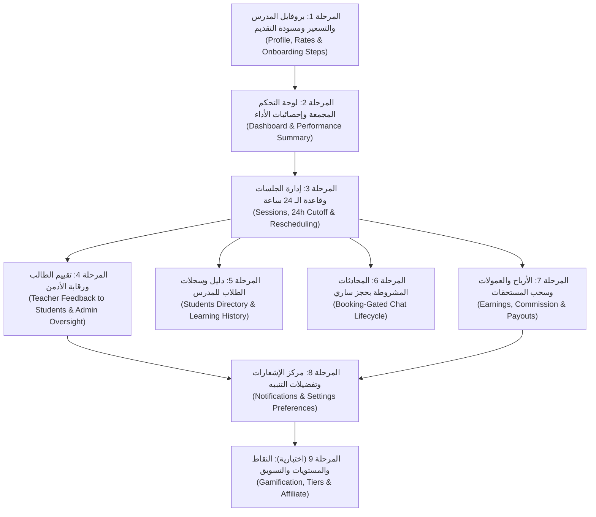

# خطة التنفيذ المرحلية لباك إند تطبيق المعلم (SOPHIA Teacher App - Backend Implementation Plan)

> **الهدف:** خارطة طريق هندسية تفصيلية ومرحلية (Phase-by-Phase) لتنفيذ كافة الـ Endpoints والكيانات وقواعد العمل الخاصة بتطبيق المعلم (**Teacher App**) والربط مع الأدمن وتطبيق الطالب وفق مواصفات الـ UI/UX ووثيقة `SOPHIA Teacher App README`.

---

## 1. خريطة المراحل الهندسية (Phased Implementation Roadmap)

---

## المرحلة 1: بروفايل المدرس، التسعير، ومسودة التقديم (Profile, Rates & Onboarding)
> **الهدف:** تمكين المدرس من حفظ طلب التقديم خطوة بخطوة، وتحديد أسعار الحصص الفردية والجماعية ولغات واللهجات بعد الاعتماد.

### 1.1 التعديلات في الكيانات وقاعدة البيانات (`LMS.Domain` & `Persistence`):
* **تحديث `InstructorApplication` / `Instructor`:**
  * إضافة `ArabicDialects` (Flags / Collection: مصري، فصحى، شامي، خليجي).
  * إضافة `TeachingLanguages` (Collection: English, Arabic, French, Spanish).
  * إضافة `IntroVideoUrl` (رابط فيديو تعريفي اختياري مدته دقيقتان).
  * إضافة `PrivateHourlyRate` (سعر الحصة الفردية 1-to-1).
  * إضافة `GroupSeatRate` (سعر المقعد الجماعي).
  * إضافة `MaxGroupSeats` (سعة المقاعد للحصة الجماعية، افتراضي 6).
  * إضافة `OffersFreeTrial` (خيار تقديم حصة تجريبية 10 دقائق).
  * إضافة `IsPublished` (حالة ظهور البروفايل في الماركت بليس للطلاب).
  * حفظ خطوة التقديم الحالية `ApplicationCurrentStep` (1 إلى 6).

### 1.2 الـ Endpoints المطلوب تنفيذها:
| Method | Endpoint | الوظيفة |
| :--- | :--- | :--- |
| `GET` | `/api/v1/teacher/application` | جلب المسودة الحالية لطلب المدرس لمعرفة أين توقف |
| `PUT` | `/api/v1/teacher/application/about` | حفظ الجنسية، المنطقة الزمنية، اللغات، واللهجات |
| `PUT` | `/api/v1/teacher/application/experience` | حفظ سنوات الخبرة، المؤهل، ونبذة Bio (30+ حرف) |
| `POST` | `/api/v1/teacher/application/documents` | رفع الشهادة التعليمية (مطلوبة) |
| `DELETE` | `/api/v1/teacher/application/documents/{id}` | حذف وثيقة قبل الاعتماد |
| `POST` | `/api/v1/teacher/application/intro-video` | رفع فيديو المقدمة الاختياري |
| `POST` | `/api/v1/teacher/application/submit` | التحقق الشامل من اكتمال الشروط وتقديم الطلب للمراجعة |
| `PUT` | `/api/v1/teacher/profile/rates` | تعديل أسعار الحصص الخاصة والمجموعات وسعة المقاعد |
| `PUT` | `/api/v1/teacher/profile/teaching` | تعديل اللغات واللهجات |
| `POST` | `/api/v1/teacher/profile/publish` | نشر الملف الشخصي ليصبح متاحاً للبحث والحجز |
| `POST` | `/api/v1/teacher/profile/unpublish` | إخفاء الملف الشخصي مؤقتاً من نتائج البحث |

---

## المرحلة 2: الداشبورد المجمع وإحصائيات الأداء (Dashboard & Stats)
> **الهدف:** تجميع كافة مؤشرات الشاشة الرئيسية لتطبيق المدرس في Endpoint سريعة واحدة، تشمل الأرباح والحصص وتنبيهات الإنذارات.

### 2.1 الـ Endpoints المطلوب تنفيذها:
| Method | Endpoint | الوظيفة |
| :--- | :--- | :--- |
| `GET` | `/api/v1/teacher/dashboard` | **الداشبورد المجمع:** أرباح الشهر، ساعات التدريس، الطلاب النشطين، وحصص اليوم وحالة الإنذار |
| `GET` | `/api/v1/teacher/dashboard/today-sessions` | قائمة حصص اليوم المباشرة مع مؤشر `canJoinNow` وزر الانضمام |
| `GET` | `/api/v1/teacher/dashboard/summary` | ملخص الكروت الرقمية فقط (Earnings, Hours, Students) |
| `GET` | `/api/v1/teacher/dashboard/performance` | إحصائيات شاشة T09 (نسبة الحضور %، متوسط التقييم، نسبة الطلاب المتكررين) |
| `GET` | `/api/v1/teacher/attendance/warnings` | الاستعلام عن سجل غيابات المدرس وحالة الإنذار الحالية (1 من 3، إنذار أخير، إلخ) |

---

## المرحلة 3: إدارة الجلسات وقاعدة الـ 24 ساعة (Sessions & 24h Cutoff) [مكتملة]
> **الهدف:** تطبيق الشروط الزمنية غير المتماثلة لإلغاء وتعديل الحصص، مع دورة موافقة الطالب على الموعد البديل.

### 3.1 قواعد العمل الصارمة (Business Rules):
* **قاعدة TBR-007:** المدرس لا يحق له الإلغاء أو طلب إعادة الجدولة إذا تبقى أقل من **24 ساعة** على موعد الحصة.
* **قاعدة TBR-008 & TBR-009:** عند طلب المدرس إعادة الجدولة، يظل الموعد القديم محجوزاً حتى يوافق الطالب على الموعد المقترح، وتُمنع الجدولة الأحادية من طرف المدرس.
* **قاعدة TBR-010:** لا يُسمح بأكثر من طلب إعادة جدولة معلق واحد لكل حصة.
* **قاعدة فحص تعارض الإجازات:** فحص وجود حصص مؤكدة للمدرس قبل السماح بتفعيل وضع الإجازة (`Vacation Mode`).

### 3.2 الـ Endpoints التي تم تنفيذها:
| Method | Endpoint | الحالة | الوظيفة |
| :--- | :--- | :--- | :--- |
| `POST` | `/api/v1/teacher/sessions/{id}/cancel` | تم التنفيذ | إلغاء المدرس للحصة (مشروط بمرور أكثر من 24 ساعة) |
| `POST` | `/api/v1/teacher/sessions/{id}/reschedule-requests` | تم التنفيذ | اقتراح موعد بديل للطالب (مع حجز مؤقت للموعد الجديد) |
| `GET` | `/api/v1/teacher/reschedule-requests?status=pending` | تم التنفيذ | قائمة الطلبات المعلقة بانتظار رد الطالب |
| `POST` | `/api/v1/teacher/reschedule-requests/{id}/withdraw` | تم التنفيذ | سحب المدرس لطلبه قبل موافقة الطالب |
| `GET` | `/api/v1/teacher/sessions/{id}/participants` | تم التنفيذ | جلب قائمة الطلاب المشاركين في الحصة (فردية أو جماعية) |
| `PUT` | `/api/v1/teacher/availability/vacation-mode` | تم التنفيذ | تفعيل/تعطيل وضع الإجازة مع إرجاع فلاج التعارضات وإطلاق Hangfire Job في الخلفية |

---

## المرحلة 4: تقييم المدرس للطالب ورقابة الأدمن (Teacher Feedback)
> **الهدف:** بناء نموذج استبيان تقييم أداء الطالب بعد الحصة، مع إمكانية إشراف ومراقبة الأدمن لكافة التقييمات.

### 4.1 الكيانات وقاعدة البيانات:
* **`FeedbackQuestion` & `FeedbackOption`:** بنك أسئلة التقييم الذي يديره الأدمن (الفهم، المشاركة، النطق، الواجب، النجوم).
* **`SessionStudentFeedback`:** إجابات المدرس على الحصة لطالب محدد:
  * `SessionId`, `LearnerId`, `InstructorId`.
  * حقول المعايير: `Understanding`, `Participation`, `Pronunciation`, `Homework`, `OverallRating`, `NextGoal`.
  * قيد فريد مركب لمنع تكرار تقييم نفس الطالب في نفس الحصة.

### 4.2 الـ Endpoints المطلوب تنفيذها:
| Method | Endpoint | الصلاحية | الوظيفة |
| :--- | :--- | :--- | :--- |
| `GET` | `/api/v1/teacher/feedback/questions` | Mدرس | جلب أسئلة وخيارات التقييم المعتمدة |
| `GET` | `/api/v1/teacher/feedback/eligible-sessions` | مدرس | قائمة الحصص المكتملة المؤهلة للتقييم |
| `POST` | `/api/v1/teacher/feedback` | مدرس | إرسال تقييم الطالب للحصة |
| `GET` | `/api/v1/teacher/feedback/submissions` | مدرس | استعراض التقييمات السابقة التي أرسلها |
| `GET` | `/api/v1/sessions/{id}/student-feedback` | طالب / مدرس | عرض بطاقة التقييم الخاصة بتلك الحصة |
| `GET` | `/api/v1/admin/student-feedbacks` | أدمن | **لوحة الأدمن:** مراقبة كل تقييمات المدرسين مع فلاتر وبحث |
| `GET` | `/api/v1/admin/student-feedbacks/{id}` | أدمن | استعراض تفاصيل تقييم فردي |

---

## المرحلة 5: دليل الطلاب وسجلاتهم في تطبيق المدرس (Students Tab)
> **الهدف:** تمكين المدرس من استعراض الطلاب المرتبطين به وتتبع نسبة حضورهم وتاريخ حصصهم وتقدمهم التعليمي.

### 5.1 قواعد العمل:
* المدرس يرى فقط الطلاب الذين لديهم حجز مؤكد أو حصص سابقة معه.
* لا يتم كشف أي بيانات شخصية غير مصرح بها للمدرس (مثل وسيلة الدفع أو رقم الهاتف).

### 5.2 الـ Endpoints المطلوب تنفيذها:
| Method | Endpoint | الوظيفة |
| :--- | :--- | :--- |
| `GET` | `/api/v1/teacher/students` | استعراض قائمة طلاب المدرس مع نسبة حضور كل طالب وإجمالي حصصه |
| `GET` | `/api/v1/teacher/students/{studentId}` | بطاقة تفاصيل الطالب (المستوى، اللهجة، الهدف التعليمي) |
| `GET` | `/api/v1/teacher/students/{studentId}/sessions` | سجل الحصص التاريخية المشتركة مع هذا الطالب |
| `GET` | `/api/v1/teacher/students/{studentId}/progress` | ملخص التقدم في الدروس (مثل: أنهى 3 من 12 درساً) |
| `GET` | `/api/v1/teacher/students/{studentId}/attendance` | سجل الحضور والغياب الخاص بالطالب في حصص المدرس |

---

## المرحلة 6: المحادثات المشروطة بحجز ساري (Booking-Gated Chat)
> **الهدف:** توفير محادثة فورية مشروطة بوجود حجز فعال؛ بحيث تتحول إلى قراءة فقط بمجرد انتهاء العلاقة التدريسية.

### 6.1 قواعد العمل الصارمة (TBR-017 & TBR-018):
* المحادثة تكون `Active` فقط إذا كان هناك حجز ساري (حصة مستقبلية مؤكدة).
* عند اكتمال أو إلغاء الحصة وعدم وجود حجز جديد، تتحول المحادثة تلقائياً إلى **`Closed (Read-Only)`**.
* يُمنع إرسال أي رسالة جديدة برمجياً في الـ Backend إذا كانت المحادثة `Closed` (مع إمكانية قراءة السجل القديم).
* أي حجز جديد بين نفس الطالب والمدرس يعيد فتح المحادثة تلقائياً.

### 6.2 الـ Endpoints المطلوب تنفيذها:
| Method | Endpoint | الوظيفة |
| :--- | :--- | :--- |
| `GET` | `/api/v1/teacher/chats` | قائمة محادثات المدرس مع تمييز حالة كل محادثة (`Active` أم `Closed`) |
| `GET` | `/api/v1/teacher/chats/{chatId}/messages` | سجل الرسائل مع Pagination |
| `POST` | `/api/v1/teacher/chats/{chatId}/messages` | إرسال رسالة (مع التحقق الصارم من حالة الحجز) |
| `POST` | `/api/v1/teacher/chats/{chatId}/read` | تحديث قراءة الرسائل وتصفير عداد غير المقروء |

---

## المرحلة 7: الأرباح والعمولات وسحب المستحقات (Earnings & Payouts)
> **الهدف:** إدارة الحسابات المالية للمدرس، وتطبيق عمولة المنصة، وفصل الرصيد المعلق عن المتاح، وإدارة طلبات التحويل البنكي.

### 7.1 القواعد المالية:
* حساب صافي الربح في السيرفر: $$\text{Net} = \text{Gross} - \text{Platform Commission}$$
* نسبة العمولة تدار من قبل الأدمن والباك إند ولا يتم تمريرها من الفرونت إند إطلاقاً.
* الفصل بين الأرباح المعلقة `Pending Settlement` والأرباح المتاحة فعلياً للسحب `Available Balance`.
* السماح بطلب سحب واحد معلق في المرة الواحدة للمدرس لمنع التكرار (TBR-025).

### 7.2 الـ Endpoints المطلوب تنفيذها:
| Method | Endpoint | الصلاحية | الوظيفة |
| :--- | :--- | :--- | :--- |
| `GET` | `/api/v1/teacher/earnings/summary` | مدرس | كشف الأرباح الشامل (Gross, Commission, Net, Pending, Available) |
| `GET` | `/api/v1/teacher/earnings/transactions` | مدرس | سجل العمليات المالية لكل حصة |
| `GET` | `/api/v1/teacher/earnings/monthly` | مدرس | ملخص الشهور السابقة للرسم البياني |
| `GET` | `/api/v1/teacher/payouts` | مدرس | سجل طلبات السحب البنكي وحالاتها |
| `POST` | `/api/v1/teacher/payouts` | مدرس | تقديم طلب سحب رصيد متاح |
| `GET` | `/api/v1/teacher/payout-methods` | مدرس | استرجاع بيانات الحساب البنكي المسجل |
| `PUT` | `/api/v1/teacher/payout-methods/{id}` | مدرس | تحديث بيانات الحساب البنكي |
| `GET` | `/api/v1/admin/payouts` | أدمن | استعراض طلبات السحب المعلقة للمدرسين |
| `POST` | `/api/v1/admin/payouts/{id}/approve` | أدمن | اعتماد طلب السحب وتأكيد التحويل |
| `POST` | `/api/v1/admin/payouts/{id}/reject` | أدمن | رفض طلب السحب مع سبب الرفض وإعادة الرصيد للمدرس |

---

## المرحلة 8: مركز الإشعارات وإعدادات التنبيه (Notifications & Settings)
> **الهدف:** توفير مركز تنبيهات داخل التطبيق مع ضبط تفضيلات الخصوصية وتغيير كلمة المرور.

### 8.1 الـ Endpoints المطلوب تنفيذها:
| Method | Endpoint | الوظيفة |
| :--- | :--- | :--- |
| `GET` | `/api/v1/teacher/notifications` | جلب قائمة الإشعارات (حجز جديد، طلب جدولة، إلغاء، تحويل أرباح، إنذار غياب) |
| `GET` | `/api/v1/teacher/notifications/unread-count` | عدد التنبيهات غير المقروءة لعلامة الجرس |
| `POST` | `/api/v1/teacher/notifications/{id}/read` | تمييز إشعار معين كمقروء |
| `POST` | `/api/v1/teacher/notifications/read-all` | تمييز جميع الإشعارات كمقروءة |
| `GET` | `/api/v1/teacher/settings` | جلب إعدادات وتفضيلات حساب المدرس |
| `PUT` | `/api/v1/teacher/settings/password` | تغيير كلمة المرور |
| `PUT` | `/api/v1/teacher/settings/notifications` | تفعيل/إلغاء تنبيهات الحجوزات والرسائل والظهور بالبحث |

---

## المرحلة 9 (اختيارية): النقاط ورابط الإحالة (Achievements & Affiliate)
> **الهدف:** دعم ميزات التلعيب (Gamification)، نقاط المدرس، وترتيب المتصدرين، ورابط الإحالة.

### 9.1 الـ Endpoints:
| Method | Endpoint | الوظيفة |
| :--- | :--- | :--- |
| `GET` | `/api/v1/teacher/achievements` | رصيد النقاط (مثال: 980 pts - Gold Tier) والإنجازات المحققة |
| `GET` | `/api/v1/teacher/rank` | ترتيب المدرس في قائمة المتصدرين (Leaderboard) |
| `GET` | `/api/v1/teacher/affiliate` | رابط الإحالة وإحصائيات النقرات والتسجيلات والحجوزات |
| `POST` | `/api/v1/teacher/affiliate/link` | توليد رابط إحالة مخصص للمدرس |

---

## معايير الجودة والتحقق (Definition of Done لكل مرحلة):
1. كتابة الـ Entities والـ Fluent API Configurations المقابلة مع تطبيق قيود الـ Soft Delete والـ Concurrency.
2. إنشاء وتشغيل الـ Migrations والتأكد من انعدام دورات الحذف المتتالي (No Multiple Cascade Paths).
3. تغطية الـ Handlers والـ Validators بقواعد التحقق الصارمة (FluentValidation).
4. بناء الـ Endpoints داخل `LMS.API` مع Swagger Documentation والـ ApiResponse الموحد.
5. التحقق من سلامة البناء (`0 Errors, 0 Warnings`) واختبار الـ Endpoints.

